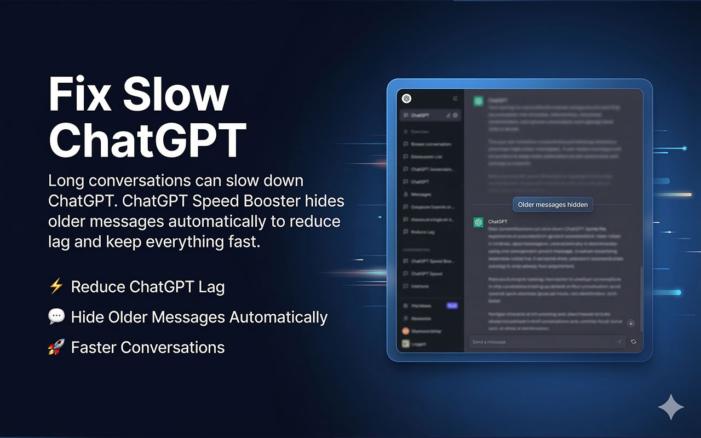

# ChatGPT Speed Booster: Fix Slow ChatGPT in Long Conversations

ChatGPT Speed Booster is a free Chrome extension that fixes lag in long ChatGPT conversations. It keeps only the most recent messages rendered on the page and hides the older ones, so typing and scrolling stay fast. Nothing is deleted from your chat.

**[Install from the Chrome Web Store](https://chromewebstore.google.com/detail/jflohdkooepdoofnhmifkbliamlmhjjj?utm_source=github&utm_medium=readme&utm_campaign=chatgpt_speed_booster)** | **[Full guide and FAQ](https://www.addonschrome.com/extensions/chatgpt-speed-booster.html?utm_source=github&utm_medium=readme&utm_campaign=chatgpt_speed_booster)** | **[Video demo](https://www.youtube.com/watch?v=NPH_k5eXd6E)**

This repository is the public home for ChatGPT Speed Booster documentation, release notes and the issue tracker. The extension itself is distributed through the Chrome Web Store.

## Why long ChatGPT chats get slow

In a long conversation the browser keeps every message in the page. The more messages there are, the heavier the page becomes, and typing, scrolling and streaming answers start to lag. The slowdown is in the browser tab, which is why starting a new chat feels fast again.

## What the extension does

- Keeps the most recent messages visible and hides the older ones
- Lets you choose how many messages stay rendered, from 1 to 200
- Shows live numbers for the conversation: visible, total and hidden messages
- Can be switched off at any time to bring the whole conversation back
- Deletes nothing: your conversation history in ChatGPT is untouched

## How to use it

1. Install ChatGPT Speed Booster from the [Chrome Web Store](https://chromewebstore.google.com/detail/jflohdkooepdoofnhmifkbliamlmhjjj?utm_source=github&utm_medium=readme&utm_campaign=chatgpt_speed_booster).
2. Open a long conversation in ChatGPT.
3. Open the extension, turn on performance mode and set the message limit.
4. Keep working in the same chat without the lag.

The [full guide](https://www.addonschrome.com/extensions/chatgpt-speed-booster.html?utm_source=github&utm_medium=readme&utm_campaign=chatgpt_speed_booster) explains the settings and answers common questions about slow ChatGPT.

## Pricing and privacy

The extension is free. It works locally in your browser and only changes what is rendered on the page.

## Screenshots

## Support and feedback

Found a bug or want a feature? [Open an issue](../../issues) in this repository. Please include your Chrome version and the steps that led to the problem.

## Disclaimer

ChatGPT Speed Booster is an independent tool and is not affiliated with, endorsed by or sponsored by OpenAI. ChatGPT is a trademark of OpenAI.

---

Built and maintained by [Addons Chrome](https://www.addonschrome.com/?utm_source=github&utm_medium=readme&utm_campaign=chatgpt_speed_booster).
